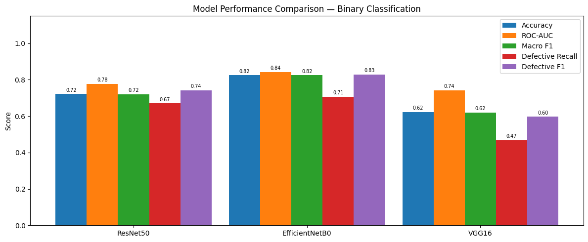
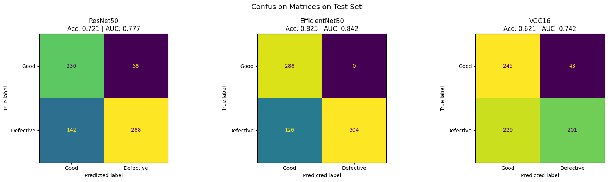
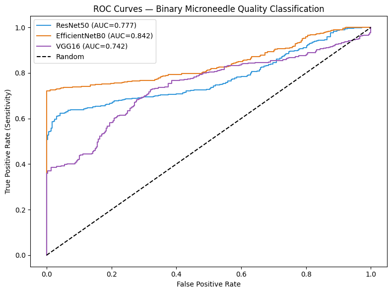
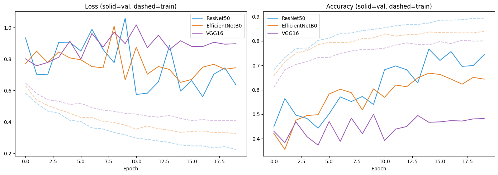
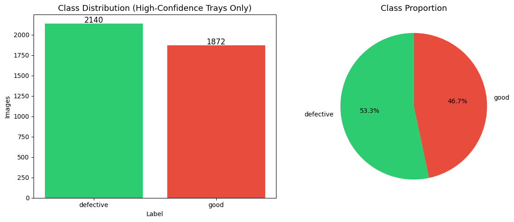
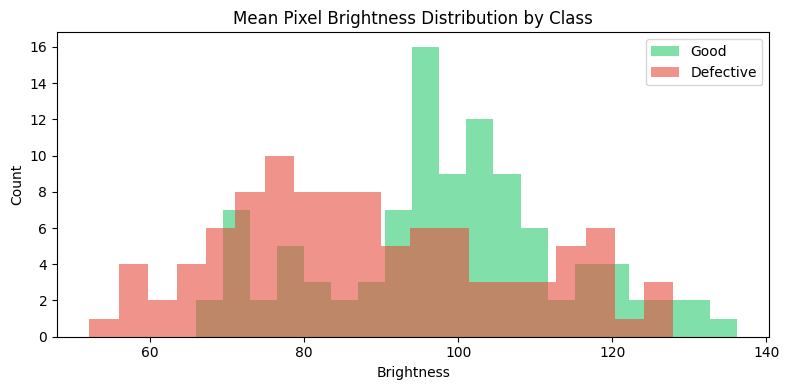
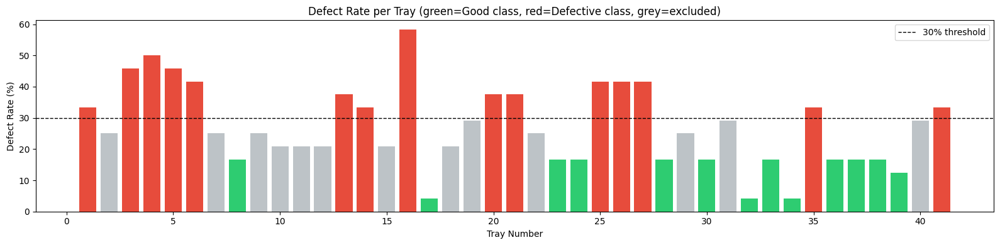
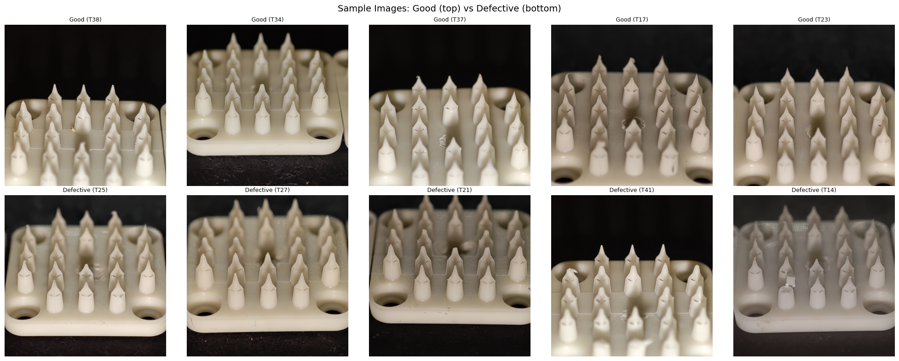

# Microneedle Quality Classification

MSc machine learning project (2026).

Microneedle patches are manufactured in trays, and defective patches have to be caught before they go any further. This project trains image classifiers to label each patch as **good** or **defective**, and compares three transfer-learning backbones.

## Approach

- **Labels:** quality scores come from an Excel log per tray. Only high-confidence trays are kept (defect rate clearly above or below a 30% threshold); ambiguous trays are excluded so they don't add label noise.
- **Split:** train, validation and test, with augmentation on the training set only.
- **Models (PyTorch):** ResNet50, EfficientNetB0 and VGG16, all pretrained on ImageNet and fine-tuned.
- **Evaluation:** accuracy, ROC-AUC, per-class F1, and defective-class recall, since a missed defect costs more than a false alarm.

## Results (test set, 718 images)

| Model | Accuracy | ROC-AUC | Macro F1 | Defective recall | Defective precision |
|---|---|---|---|---|---|
| ResNet50 | 0.721 | 0.777 | 0.720 | 0.670 | 0.832 |
| **EfficientNetB0** | **0.825** | **0.842** | **0.824** | **0.707** | **1.000** |
| VGG16 | 0.621 | 0.742 | 0.620 | 0.467 | 0.824 |

EfficientNetB0 never flagged a good patch as defective, and it was best on every metric.



| Confusion matrices | ROC curves |
|---|---|
|  |  |



## Exploratory analysis

| Class distribution | Brightness by class |
|---|---|
|  |  |





## Data

The image dataset and labels come from a lab and are not public, so they are not included here.

## Running it

The notebook was run on Kaggle with a GPU. Set `DATA_DIR` to the dataset folder and `OUTPUT_DIR` to a writable folder.

```bash
pip install -r requirements.txt
```

**Tech:** Python, PyTorch, torchvision, scikit-learn, pandas, seaborn
